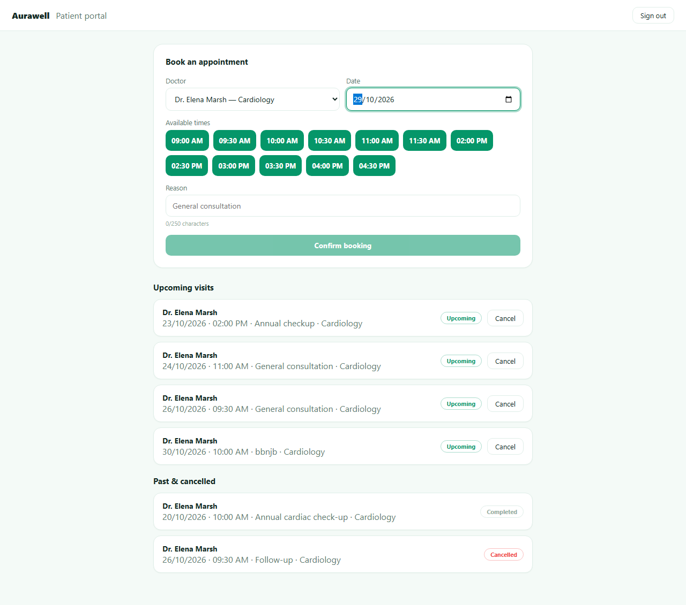
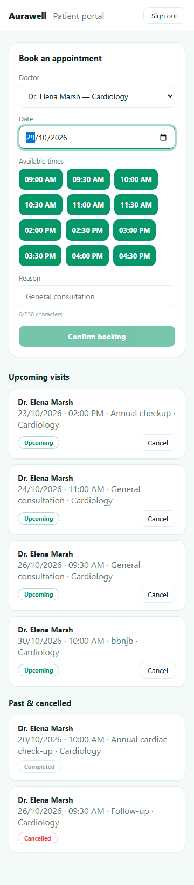
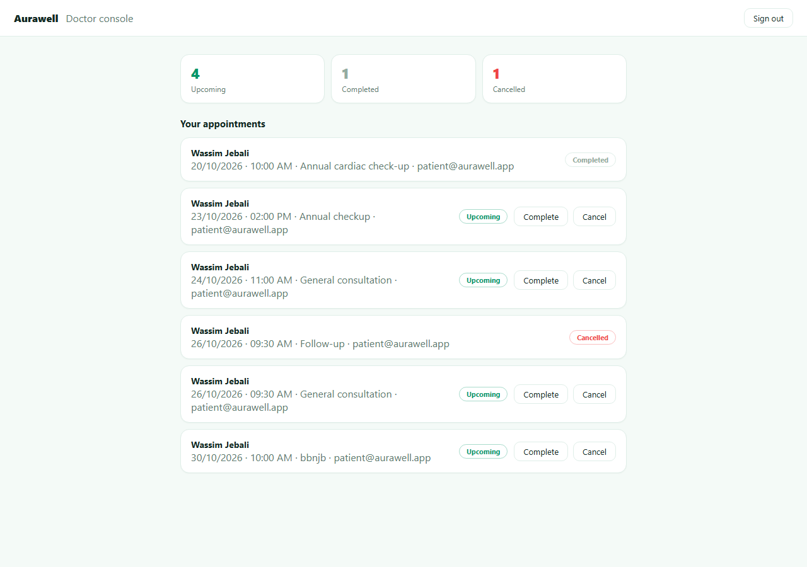

# Aurawell

**Care coordination, simplified** — one appointment ledger, two purpose-built views: a patient portal and a doctor console.

This is the standalone full-stack app behind the [in-browser demo](https://portfoliowassim.vercel.app/demo/aurawell) on my [portfolio](https://portfoliowassim.vercel.app). The portfolio demo simulates the backend client-side for instant, zero-setup interaction; this repo is the real thing — a Node/Express API over PostgreSQL, with role-based JWT authentication.

| Patient portal (1280px) | Patient portal (360px) | Doctor console (1280px) |
|---|---|---|
|  |  |  |

## Features

- 🔐 JWT authentication with a `role` claim (`patient` / `doctor`)
- 📅 Guided booking flow: pick a doctor, pick a date, choose from **live availability** (`GET /api/doctors/:id/availability`) rendered as slot pills — booked slots are disabled, past slots disappear, and the free-text time field is gone
- 🚫 Double-booking is impossible by construction — `(doctorId, date, time)` is a **partial unique DB index** on active appointments, not just a UI check (cancelled slots can be rebooked)
- 🗓️ Patients see **Upcoming visits** vs **Past & cancelled** sections with status badges
- 🩺 Doctor console with summary counts (upcoming / completed / cancelled) and one-click **Complete** / **Cancel** per visit
- ❌ Patients cancel through a confirmation modal; the update is optimistic with rollback and a visible error if the API fails; only upcoming visits can be cancelled
- 🛡️ Validation with zod (real calendar dates, no past dates, slot whitelist), login rate limiting (429 after 10 attempts / 15 min by default), and server error messages surfaced in the UI
- ♿ Accessible: labels tied to inputs, `:focus-visible` rings, `role="status"` / `role="alert"` live regions, modal focus handling with Escape-to-close, responsive from 360px width up
- Seeded demo patient and doctor so the app works out of the box

## Architecture

```
React + Vite (components + hooks) ──/api──► Express (JWT + zod + rate-limit) ──► Prisma ──► PostgreSQL
   Patient and doctor dashboards are different queries over one Appointment table
```

## API

| Method | Route | Description |
|---|---|---|
| `POST` | `/api/auth/login` | Exchange email + password for a JWT (rate limited, 429 on abuse) |
| `GET` | `/api/doctors` | List doctors and specialties |
| `GET` | `/api/doctors/:id/availability?date=YYYY-MM-DD` | All/booked/available slots for a doctor on a date |
| `GET` | `/api/appointments` | List the caller's appointments (patient) or booked-with-them (doctor); `?status=` filter and `?limit=` supported |
| `POST` | `/api/appointments` | Book an appointment (patients only; 400 invalid time/date, 409 slot taken) |
| `PATCH` | `/api/appointments/:id/cancel` | Cancel your own upcoming appointment |
| `PATCH` | `/api/appointments/:id/status` | Doctor marks one of their upcoming visits `completed` or `cancelled` |

All routes except `/api/auth/login` require `Authorization: Bearer <token>`.

## Run it

```bash
docker compose up --build
```

- App: http://localhost:5173
- API: http://localhost:4400/api/health

> **Note:** the `JWT_SECRET` in `docker-compose.yml` (`change-me-in-production`) is a **demo value** for local development only. Override it with a real secret in any deployment — the API refuses to boot in production without one.

Demo logins (both use `demo1234`):
- `patient@aurawell.app` — patient portal
- `doctor@aurawell.app` — doctor console

### Environment variables

| Variable | Used by | Default | Purpose |
|---|---|---|---|
| `DATABASE_URL` | API | set in compose | PostgreSQL connection string |
| `PORT` | API | `4400` | HTTP port |
| `JWT_SECRET` | API | dev fallback | JWT signing secret (**required in production**; compose uses a demo value) |
| `CORS_ORIGIN` | API | `http://localhost:5173` | Comma-separated allowed origins |
| `RATE_LIMIT_WINDOW_MS` | API | `900000` (15 min) | Login rate-limit window |
| `RATE_LIMIT_MAX_ATTEMPTS` | API | `10` | Login requests allowed per window per IP |
| `TEST_DATABASE_URL` | API tests | test fallback | Database used by `npm test` (falls back to `DATABASE_URL`) |

### Tests

```bash
cd api
npm test   # node --test runner, 30 tests against TEST_DATABASE_URL
```

### Without Docker

```bash
# API
cd api && cp ../.env.example .env && npm install && npm run db:push && npm run seed && npm run dev

# Web (separate terminal)
cd web && npm install && npm run dev
```

## Tech stack

React · Vite · Express · Prisma · PostgreSQL · JWT · zod · Docker

## License

MIT — see [LICENSE](./LICENSE).
